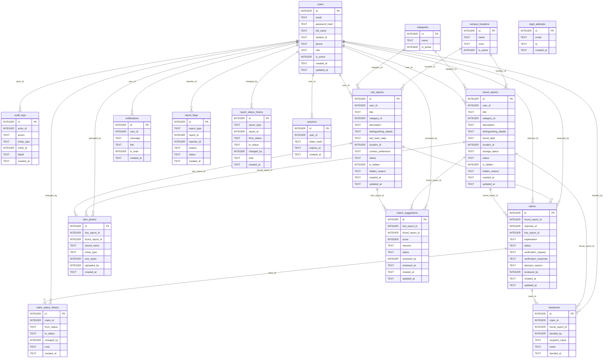

# Entity-relationship diagram

_Generated by `npm run docs:generate` from the real foreign keys. Do not edit by hand._

Cardinality is drawn as one-to-many for every foreign key; UNIQUE indexes (e.g. `handovers.found_report_id`) make some of them effectively one-to-one — see the data dictionary.
